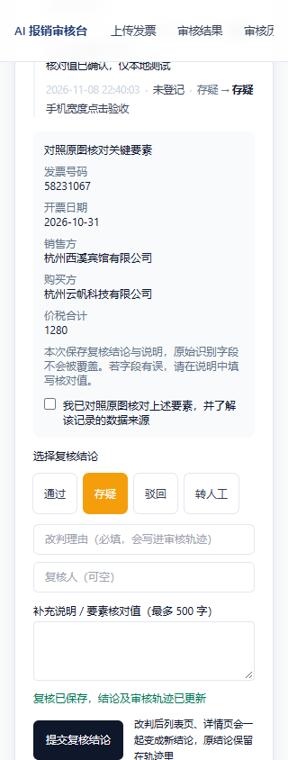
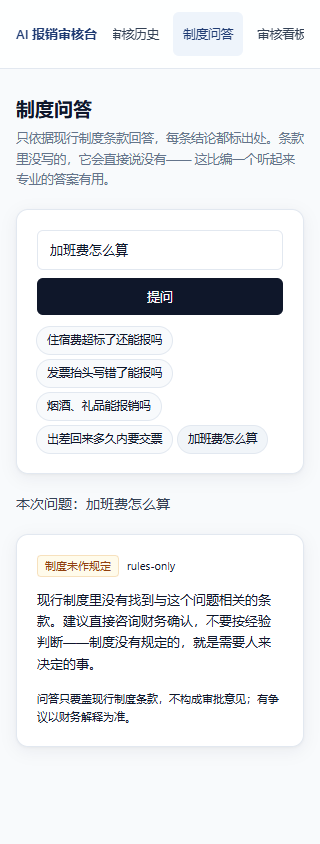
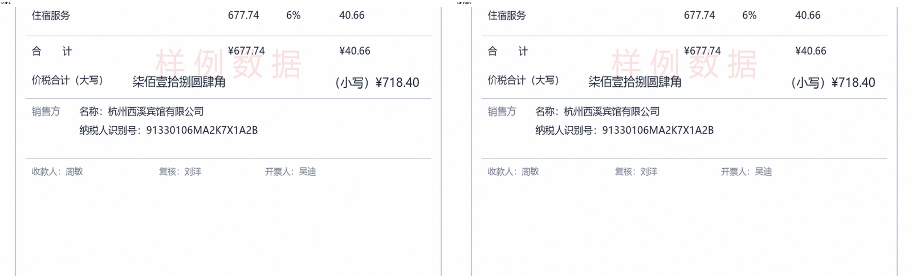

# B 前端续作交付 · 2026-11-08

> 最新状态：11 月 9 日晚已同步 60 张终版、C 已确认两批名单并提交实测补报。本文为历史验收，当前交付与剩余事项见 [B今日工作总结-20261109.md](B今日工作总结-20261109.md)。

基于 main 57d580d，分支 feat/b-review-upload-polish。PR #1 已由 A 合入；本次以 A 新增的人工复核和制度问答接口为基础继续完善前端。

## 已实现

- 复核前展示号码、日期、销售方、购买方、金额，缺失字段显式提示，确认核对后提交。
- 增加补充说明（500 字）、改判理由（200 字）、复核人（40 字）的契约约束；记录中文改判前后状态，成功提示，失败保留输入，提交期间锁定控件并用同步锁防重复。
- 目前接口只支持改判和 note，不支持修正识别字段。页面明确说明核对值只进入补充说明，不覆盖原字段、不改变原金额统计。真正字段修改/重新审计闭环仍需 A 提供接口，不能把本次交付说成已经完成该闭环。
- 上传前提供可选压缩，默认关闭。大于等于 1 MiB 的图最长边限制 2560，JPEG 质量 0.92；压缩变大或解码失败回退原图，顺序处理并展示进度，始终保留本地原文件。未验证压缩对真实票面识别准确率的影响。
- 批次、卡片和详情统一 SourceNotice，移除合并后重复的模拟提示。
- 制度问答防止回车/示例按钮重复请求；显示本次问题，失败保留问题可重试，清除旧答案避免答非所问。

## 验证与边界

后端 130 项回归通过；前端 typecheck、生产 build（含 lint）通过。本地隔离数据库验证空理由 422、带 note 改判成功、原字段保留及列表详情结论一致。没有改动线上审核记录。

C 数据固定基准日 2026-11-06：本报告原验收为 40/40。11 月 9 日同步 main 2f519dd 后扩展至 58 张，独立、整批均结论 58/58、规则 58/58，R2 正常置信度缺字段样例已覆盖。上述数字仅为规则对拍，不是 OCR 准确率；最新交付见 [B实拍联调交付-20261109.md](B实拍联调交付-20261109.md)。

原内置浏览器验收受阻，现已使用独立 Edge/Playwright 在本地隔离库完成验收，结果见下文。

## 联调与部署

正式联调地址：http://8.217.202.172。只读检查 /api/health 和演示 /results 均 HTTP 200；线上 D8-review-qa，recognition_provider=openai-compat。此项不能证明真实照片识别准确率。

api.ts 目前未配置环境变量时回退 http://127.0.0.1:8000。A 的 deploy/bootstrap.sh 已在构建时指定 NEXT_PUBLIC_API_BASE=""，上线走同源 /api 经 nginx 反代，无需将公网 IP 写死进代码。

若本地前端要直连线上，在启动/构建前设置 NEXT_PUBLIC_API_BASE=http://8.217.202.172；浏览器跨域访问还取决于线上 CORS。本次写入测试使用本地隔离库 b-1108-ui.db；真实联调须先核对页面来源，不要把 fixture 或 mock 测试当成实拍验收。

## 后续需要 A/C 配合

A：审核本次分支；明确字段修正及重新审计契约，后续意见流式输出需真实流式接口，不能用前端打字动画代替。
C：已在 main 2f519dd 交付 real_01~10.jpg 与对应 GT，原“尚未完成实拍”描述已失效。下一步为线上真模型字段级准确率对拍；目前 main 未找到 to_print_extra/print_11/12.png，后续新增两张以实际提交为准。
B：本次浏览器与响应式验收已完成；接口就绪后接字段修正和意见流式输出。

## PR #2 补充验收完成

使用独立无头 Edge，不连接个人浏览器会话。写入仅发生在本地 b-1108-ui.db，未改线上数据。

- 21 项交互/边界断言通过：未核对/空理由拦截，复核断网保留输入和重试，提交期间禁用表单且请求只有一次，成功清空输入并回显；问答失败重试、禁用示例、无重复请求；上传删除、断网保留预览、重试锁定、原图字节保留、损坏图片回退并进入失败终态、部分失败保留成功记录；320px 下实际点击复核、滚动导航和制度问答成功。
- 320/375/390/768px × 上传/详情/问答/历史/结果，共 20 组检查无整页横向溢出。历史表格、导航保留自身水平滚动。属于桌面浏览器模拟视口验收，不是 iOS/Android 实机认证。
- 发现并修复：200 字连续英文理由、500 字连续英文备注使 320px 页撑到 3305px。标题/记录增加断词换行后 scrollWidth=320；复核按钮与手机导航最小高度44px，防止标题被挤成碎行。
- 压缩样例来自仓库 print_01 合成票，放大到3200×4400并加轻微噪声；8,625,673字节 → 420,128字节（减少95.1%），输出1862×2560。人工查看同尺寸对比，税号、677.74/40.66/718.40金额、6%税率及中文抬头可辨，未见明显新增文字损伤。默认仍关闭；此结论仅限该合成样例，不代表实拍照片OCR准确率。
- 最终改动 typecheck 和生产 build（含 lint）通过；此前同基线后端130项通过，后端未改动。

本地详细证据：verification/pr2-browser-results.json、pr2-edge-cases.json、pr2-acceptance.cjs、pr2-edge-cases.cjs、pr2-long.cjs 位于 F:/ai-invoice-audit-review-20261106 下。原始测试图片与临时数据库不提交。
