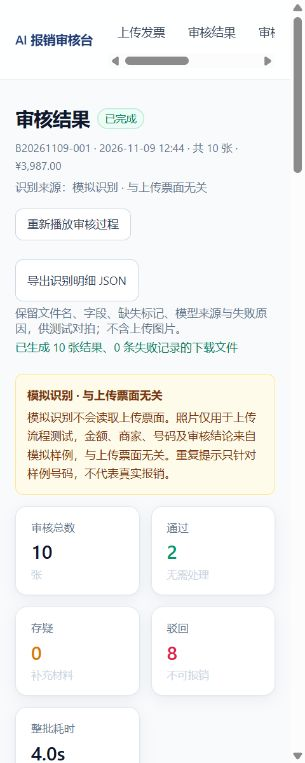

# B 实拍联调交付 · 2026-11-09

> 晚间更新：已同步 main `b1fc0d8` 的 60 张终版；C 确认 clean_render 名单，real_11/12、to_print_extra 及实测补报均已交付。以下保留白天 58 张验收记录，当前状态与交付以 [B今日工作总结-20261109.md](B今日工作总结-20261109.md) 为准。

PR #2 分支 `feat/b-review-upload-polish` 已合并 main `2f519dd`。C 的 10 张实拍已经交付，旧报告中的“实拍尚未完成”已更正。当前数据集 58 张：38 张合成票、10 张实拍、10 张非发票；不提前记为 60 张。

## B 本次完成

- 核对 `real_01~10.jpg` 及 GT 的 10 条 `augment=real_photo`，基准日均为 2026-11-06。照片均为 1080×1440，单张约 188–256 KiB。
- 修复回归测试写死 `40` 的过期断言：总数必须等于当前 GT 条数且非空，所有条目的结论仍须全部一致；没有放宽匹配要求。
- 批次结果页增加“导出识别明细 JSON”。仅结束后可导出，点击时重新取批次和逐张详情；包含文件名、识别字段、missing_fields、provider/model、规则与人工复核记录及失败原因，不含图片二进制。
- 导出期间禁用重复操作。任一详情请求失败则不生成残缺文件，显示可重试错误。各详情是请求时读取，不能视为事务一致快照。
- 生成 `real-photo-run-manifest.json`，记录来源提交、基准日及 22 个候选文件的字节数/SHA-256，供 C 固定输入后复现。

## 验收结果

后端全量 130 项回归通过（含 C 数据集 13 项）；前端 typecheck 与生产 build 通过。独立模式、整批模式均为结论 58/58、规则集合 58/58。规则评测使用 GT 字段，不经过图片识别，不能当作真实识别准确率。

浏览器在本地隔离数据库 `b-1108-ui.db`、mock-vlm 环境验收：

1. 选择 10 张实拍，预览、文件名、单张大小、2.23 MB 合计正确，压缩默认关闭；选择后才手动提交。
2. 批次 `B20261109-001` 处理结束，页面明确显示模拟来源；处理中导出不可点击。
3. 下载 JSON 含 real_01~10.jpg 十条完整详情、零条失败，provider 全为 mock-vlm。此处的金额和判定属于模拟样例，与实拍票面无关。
4. 停止本地后端后点击导出，出现连接错误且允许重试；恢复后端后重试成功。
5. 320px 视口下导出区无横向溢出，实际点击下载成功；这是桌面浏览器模拟视口验收，不是手机实机测试。

原有复核、问答、上传边界及压缩清晰度验收继续见 [11 月 8 日交付](B前端交付-20261108.md)。本轮 10 张实拍均小于 1 MiB，未触发压缩；不据此声称实拍压缩后 OCR 无损。

## 给 C 的真实识别操作顺序

1. 请 A 合并并部署 PR #2 后，在正式站点确认上传页和实际结果的来源。`recognition_provider=openai-compat` 仅说明配置选择，最终以逐张记录 provider/model 和字段响应为证据。
2. 清单的 12 张 clean_render 是候选：ds_001/002/003/004/006/008/010/011/012/018/024/030；从未增广项中排除了新增 R2 样例 ds_036/037。请 C 核实与计划的“12 张干净票”一致。干净指图像形态，不是审核通过。
3. 上传限制为每批最多 20 张，分为 12 张干净票、10 张实拍两批；基线关闭前端压缩、保持原文件名。不要用“演示数据”按钮代替上传。
4. 每批结束后立即导出 JSON，保留批次号、时间、输入清单和实际 provider/model，按文件名与 GT 对拍。请在人工改判前导出；verdict 可能被人工改判，原 fields/missing_fields 才是识别字段证据。
5. 缺失字段必须读取 missing_fields，不能把金额缺失的占位 0 当作正确的零元。预先约定字段名单、金额精度、日期和文本规范化方式，分别报告干净票与实拍的逐字段正确数/总数。失败和缺失需要纳入预定分母并单列，不能只统计成功样本。
6. GT eval_date=2026-11-06，而线上通常按实际运行日执行 R4，且重复上传会影响 R1 台账。线上审核结论与 GT 不一致时，先区分日期/台账差异与 OCR 错误；不要直接把 verdict 一致率当字段准确率。
7. 若要评估压缩影响，单独组织同一输入、同一模型配置的原图/压缩图对照并分别记录。当前默认关闭压缩的基线不会替代这项实验。

本轮未向线上提交这 22 张，也未产生真实识别准确率。D4 已知问题 #5 待 C 的真实运行结果、失败明细和字段对拍报告齐备后再闭环。

## 交给 A/C 的剩余事项

- A：审查 PR #2 并部署；本次新增后端改动仅为测试断言，不改变后端业务。字段修正/重新审计仍缺接口，本次 note 只记录说明。
- C：确认 12 张候选输入、完成真实识别报告。当前 main `2f519dd` 未找到 `to_print_extra` 或 print_11/12.png，请补充路径/提交；之后再同步 60 张终版。

本地详细证据位于 `F:/ai-invoice-audit-review-20261106/verification/`：`b-1109-eval.json`、`b-1109-tests.xml`、`b-1109-ui-check.json`。模拟导出样本不作为准确率报告提交。
