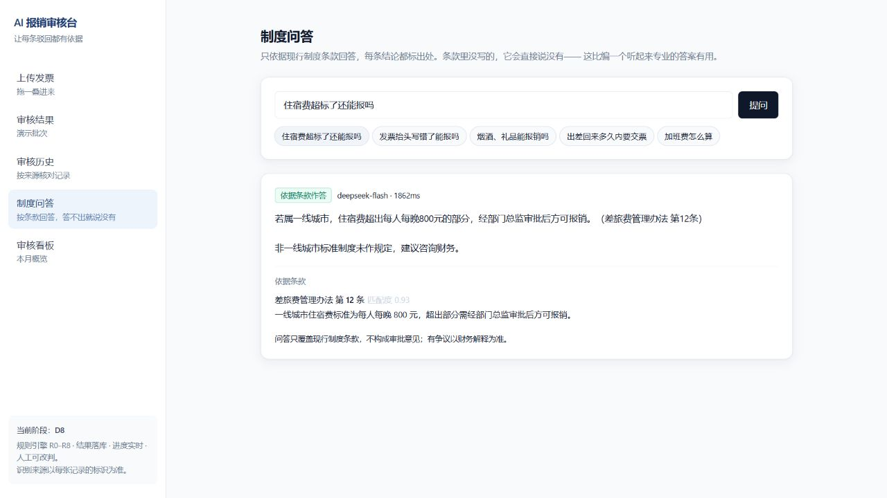
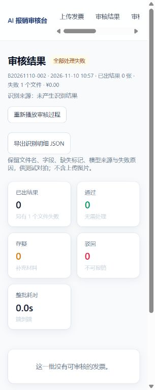

# B 线上闭环验收 · 2026-11-10

依据 A 的 D7 排练安排，使用 `http://8.217.202.172` 完成可执行的线上验收并修复发现的问题。当前 main 为 b1fc0d8；PR #2 尚未合并，B 新增功能与本次修复不能视为已经部署。

## 线上已完成

| 检查 | 实际结果 |
|---|---|
| 健康 | status=ok，0.7.0 / D8-review-qa，recognition_provider=openai-compat |
| 上传协议 | B20261110-001 的 POST 返回 HTTP 202，status=processing；不是演示模式的200 |
| 部分失败 | 上传 C 的 real_11 项目样例及损坏 JPG；终态 partial，成功1、失败1，页面显示损坏文件名及 BAD_IMAGE 原因 |
| 全部失败 | 浏览器选择并提交损坏文件，B20261110-002 终态 failed，未产生识别结果，显示文件名和原因，没有“其余照常审完” |
| 人工复核 | 仅对本次新建测试记录 INV-B20261110-001-01 操作：reject → pass → manual；两条轨迹含人员、时间、前后状态和理由 |
| 字段保留 | 改判前后 fields 相同；改判不是修改机器识别字段 |
| 卡片/详情 | 两次改判后卡片与详情状态一致；但另发现批次统计未同步，见下文修复 |
| 住宿问答 | 线上返回 deepseek-flash 回答，引用第12条；一线城市每人每晚800元，超出部分需部门总监审批；其他城市未规定部分提示咨询财务 |
| 加班费问答 | 线上显示“制度未作规定”，provider=rules-only，没有编造计算规则 |

线上只新增两个明确标记为 B_D7_20261110 的测试批次。复核人是“B/YZC830 联调”，理由明确“不代表实际报销审批”，最终转人工留存；未改他人的既有记录，也没有清理线上台账。

## 本次发现并修复

1. **复核统计不一致**：线上测试票已经转人工，结果页 batch.reject_count 仍为1、manual_count为0。修复后端批次结果、概要及分页历史列表，按当前复核后的卡片重算四类计数，保留原金额与失败清单。结果页的计数与卡片使用同一批读取的结论。新增两项回归，覆盖固定演示批次及真实上传的部分失败批次，两次改判后的三种接口。
2. **人工转人工被误称低置信度**：线上显示“96.0% 低于阈值，已转人工”。现区分“人工复核已转人工处理”与“需人工核对，原因见命中规则”，不从 manual_review 擅自推断低置信度。
3. **问答长度契约错位**：PR #2 输入框原允许500字，后端实际只收2–200字。现限制200，提交前检查2–200字，单字/空输入在前端给出错误，不请求模型。
4. **失败数量文案不清**：上传2个文件而其中1个失败，页面旧文案“共1张”容易让人以为漏件。结束后改为“已出结果1张 · 失败1个文件”，统计卡采用相同口径；重试文案改成“避免重复提交”。
5. **全部失败仍宣称模型返回字段**：只有存在实际结果卡片时才展示该批的字段来源说明。零结果显示“未产生识别结果”，不暗示模型已经识别出字段。

## 修复后的验证

- 后端全量151项通过，含新增两项复核统计回归；原有数据与评测回归继续通过。
- 前端最终 typecheck、生产 build 通过。
- 本地隔离库复验：单字问题提示2–200字、输入 maxlength=200；部分失败明确结果/失败数；手动转人工不再显示“低于阈值”；批次驳回计数从1变0；全部失败不再显示“模型已返回字段”的提示。
- 320px 模拟视口的全部失败页无整页横向溢出（document.scrollWidth=305，innerWidth=320）；这是桌面浏览器模拟，不是手机实机验收。

## 不能提前宣布完成的部分

- 本次 real_11 逐张记录为 openai-compat / deepseek-flash，但抽取轨迹耗时仅5ms，疑似复用缓存。接口没有 cached 标记，不能仅据此确认新调用或缓存；B 先前“已命中缓存”的表述在此更正为“疑似，尚无直接标记证据”。
- SSE 连接返回200和 text/event-stream，但 hello.replay=true，因为连接时任务已经结束。本次证明历史轨迹可回放，未验证一张全新发票的在线实时推理时序。
- 同号码 real_11 已有既往记录，先命中 R1 并短路后续规则，因此不能把这次说成 R3＋R4 验收。完整复现队长笔记本票仍缺用户提供的、获准上传到该服务器的图片路径；还需 A 准备不被既有 R1 记录干扰的演示环境。
- 本轮保存截图、HTTP响应与轨迹 JSON，没有录制连续五幕视频，也没有完成两轮完整计时排练。相关步骤已在更新后的 D7 脚本中保留为待办。
- 新增修改只在 PR #2，A 合并部署后需线上复验。看板等其他聚合接口未包含在本次批次统计修复范围，不能据此声称全部报表已完成改判同步验收。

## 给 A/C 的交接

A：审查本次批次计数修复和前端改动；合并部署 PR #2 后复验。准备独立演示台账或未入账的新票，避免 R1 提前终止。若需证明确实新调用模型，请在后续接口/轨迹中透出缓存命中标记。

C：当前60张终版不变。对外引用规则60/60、历史9字段全对及11字段新口径时继续分开；演示脚本已去掉“实拍没拍”的过期话术。

B：收到演示图片路径并在 A 准备好演示环境后，再完成新票R3/R4与实时SSE、连续录像和两轮排练；不以测试票改判代替真实审批。

本机完整证据：`F:/ai-invoice-audit-review-20261106/verification/d7-20261110/`，含 upload.json、results-before-review.json、detail-before-review.json、review-pass-check.json、online-final-check.json、sse.json、local-regression-cases.json、tests.xml 与截图。仓库仅提交摘要及精选截图。
